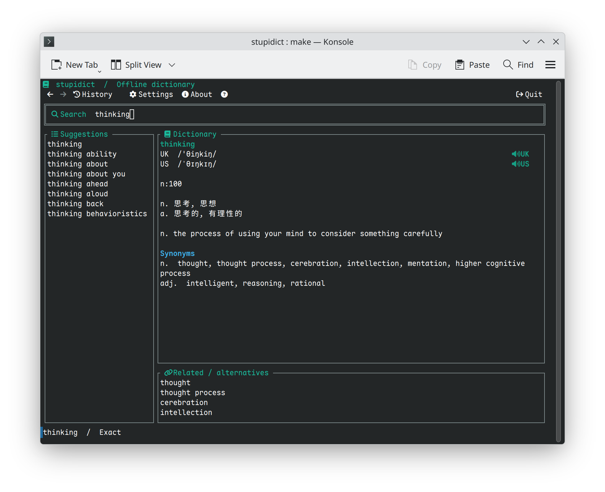

# stupidict 

A terminal-based offline English-Chinese dictionary written in Go. Independently
implements the lookup rules of [stupid-dict](https://github.com/cholf5/stupid-dict)
using the same dictionary and audio data.

## Features



- English lookup and Chinese reverse lookup, with word-form matching,
	autocomplete, and fuzzy suggestions.
- UK/US phonetics, synonyms, antonyms, and related words.
- Offline UK/US pronunciation from a local audio pack, with no external player.
- Keyboard and mouse controls, query history, and back/forward navigation.
- Opt-in, quiet clipboard lookup for newly copied English words.
- English and Chinese interfaces, light/dark themes, and optional Nerd Font or
	emoji icons.
- Automatic downloads of missing data with resumable transfers; offline use
	once data is installed.

## Installation

### Prebuilt binaries

Download an archive for your platform from the
[GitHub Releases](https://github.com/mingcheng/stupidict/releases) page and verify
it against `checksums.txt`. Builds are provided for:

| OS      | Architectures    | Notes                              |
| ------- | ---------------- | ---------------------------------- |
| Linux   | `amd64`, `arm64` | glibc-based distributions (no musl) |
| macOS   | `amd64`, `arm64` |                                    |
| Windows | `amd64`, `arm64` | `.zip` archive                     |

All release binaries include native audio playback.

### Build from source

Requires **Go 1.27.2 or newer**, Git, and GNU Make. No C compiler is needed: the
build is pure Go (`CGO_ENABLED=0`), including native audio playback.

```sh
git clone https://github.com/mingcheng/stupidict.git
cd stupidict
make build
./bin/stupidict
```

Optionally place `bin/stupidict` in a directory on your `PATH`. Use a UTF-8 terminal,
preferably at least 80x24. Linux playback requires a working system audio service
or library.

### First run

Missing dictionary and audio files download automatically on startup. Settings,
data, and query history are stored in `~/.config/stupidict/` by default. Once
installed, data is reused without startup network requests.

Data comes from the upstream [data-3 release](https://github.com/cholf5/stupid-dict/releases/tag/data-3).
To prepare it without opening the interface:

```sh
./bin/stupidict -download
```

### Useful commands

```sh
# Show version information
./bin/stupidict -version

# Reinstall the pinned data release without opening the interface
./bin/stupidict -download -update-data

# Use a separate profile
./bin/stupidict -config /path/to/profile/config.json
```

Press `F1` for keyboard help, `F3` for settings, `u` / `p` for UK/US pronunciation,
and `q` to quit.

## Releasing

Releases are built by [GoReleaser](https://goreleaser.com) in the
[release workflow](.github/workflows/release.yml) using
[.goreleaser.yaml](.goreleaser.yaml). Pushing a `v*` tag runs the tests, builds every
platform, and publishes a GitHub release with archives and checksums:

```sh
git tag -a v1.0.0 -m "v1.0.0"
git push origin v1.0.0
```

Every push and pull request is vetted, tested, and built natively on Linux, macOS, and
Windows runners. Because the code is pure Go, GoReleaser then cross-compiles all targets
on one Linux runner with `CGO_ENABLED=0`; non-tag runs produce a snapshot build as a
workflow artifact instead of a release. To try it locally with GoReleaser v2:

```sh
goreleaser release --snapshot --clean
```

This project is licensed under the MIT License. Data licensing is separate from the application code. See the
[upstream license notes](https://github.com/cholf5/stupid-dict#license) before
redistributing dictionary or audio data.
